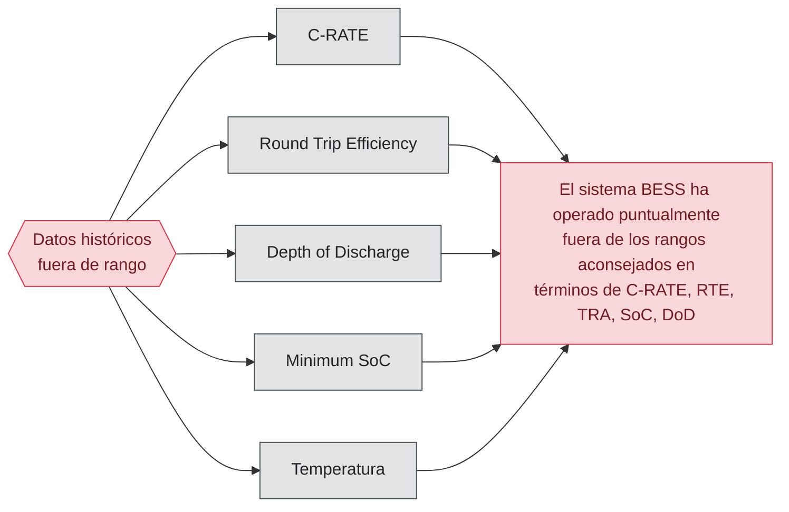
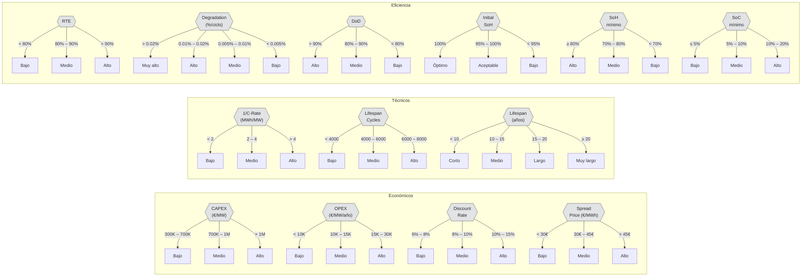
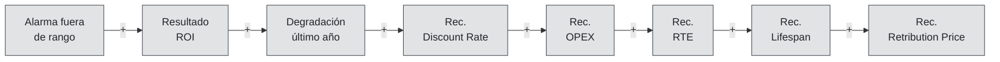

# Árbol de Decisiones BESS — Diagrama de Flujo

> Fuente: [arbol de casos bess.drawio.svg](arbol%20de%20casos%20bess.drawio.svg) / [arbol de casos bess.jpg](arbol%20de%20casos%20bess.jpg)

> **⚠️ Documento de análisis (pizarra original).** Refleja el diseño inicial. La
> implementación vigente del motor evolucionó respecto a este árbol; la
> especificación normativa actual es
> [../../02-design/motor-recomendaciones.md](../../02-design/motor-recomendaciones.md).
> Diferencias principales:
> - El tramo "no rentable" ya **no** es rojo ni desaconseja: es **azul**
>   informativo ("A valorar por el operador"), por el principio *informar, no
>   desaconsejar*.
> - El ROI se lee explícitamente **frente al coste del capital** y con dimensión
>   estratégica (`vs_capital`, `strategic`).
> - Las sub-recomendaciones se expresan como **posición margen/límite**, no
>   ok/revisar/evaluar.
> - El incumplimiento de SoH informa **a partir de qué año** se cruza el mínimo.
> - El mensaje final es **prosa en lenguaje natural**, no una concatenación con `+`.

---

## Flujo principal: Evaluación ROI + Recomendaciones

```mermaid
flowchart TB
    %% ── NODO RAÍZ ──
    ROI{{"ROI (%)"}}

    %% ── RAMAS ROI ──
    ROI -->|"ROI > i & ROI > 8%"| R1["Políticas de operación e inversión BESS rentables"]
    ROI -->|"ROI ≈ i & ROI > 8%"| R2["Inversión rentable, conveniente diversificar beneficios"]
    ROI -->|"ROI > i & ROI < 8%"| R3["Rentabilidad moderada"]
    ROI -->|"ROI < i & ROI > 8%"| R4["Rentabilidad moderada-baja"]
    ROI -->|"ROI < i & 0% ≤ ROI < 8%"| R5["Baja rentabilidad — aceptable solo si\nproyecto estratégico / bajo riesgo / sin alternativas"]
    ROI -->|"ROI < i & ROI < 0%"| R6["Inversión no rentable bajo\nparámetros actuales"]

    %% ── DEGRADACIÓN ÚLTIMO AÑO ──
    R1 & R2 & R3 & R4 & R5 & R6 --> DEG{{"Degradación último año"}}

    DEG -->|"LastYearDegr ≥ 1 − SoHmin"| D1["El ciclado compromete el SoH\nmínimo recomendado al fin de vida"]
    DEG -->|"LastYearDegr < 1 − SoHmin"| D2["Se recomienda ciclar más,\nqueda margen de degradación"]

    %% ── RECOMENDACIONES ENCADENADAS ──
    D1 & D2 --> REC["Recomendaciones adicionales"]

    REC --> DISC{{"Discount Rate"}}
    REC --> OPEX{{"OPEX"}}
    REC --> RTEC{{"RTE"}}
    REC --> LIFE{{"Lifespan"}}
    REC --> RETR{{"Retribution Price"}}

    %% ── DISCOUNT RATE ──
    DISC -->|"6% < i < 8%"| DISC_OK["Sin acción"]
    DISC -->|"8% ≤ i ≤ 10%"| DISC_W["Revisar tasa de descuento"]
    DISC -->|"10% < i < 15%"| DISC_A["Revisar tasa de descuento\ny evaluar valor más favorable"]

    %% ── OPEX ──
    OPEX -->|"< 10K €/MW"| OPEX_OK["Sin acción"]
    OPEX -->|"10K – 15K €/MW"| OPEX_W["Revisar coste de O&M"]
    OPEX -->|"15K – 30K €/MW"| OPEX_A["Revisar coste de O&M\ny evaluar valor más favorable"]

    %% ── RTE ──
    RTEC -->|"> 90%"| RTE_OK["Sin acción"]
    RTEC -->|"80% – 90%"| RTE_W["Revisar RTE"]
    RTEC -->|"< 80%"| RTE_A["Revisar RTE\ny evaluar valor más favorable"]

    %% ── LIFESPAN ──
    LIFE -->|"≥ 20 años"| LIFE_OK["Sin acción"]
    LIFE -->|"15 – 20 años"| LIFE_W["Sin acción"]
    LIFE -->|"10 – 15 años"| LIFE_WW["Considerar aumentar vida útil"]
    LIFE -->|"< 10 años"| LIFE_A["Aumentar vida útil\nde la instalación BESS"]

    %% ── RETRIBUTION PRICE ──
    RETR -->|"> 45 €/MWh"| RETR_OK["Sin acción"]
    RETR -->|"30 – 45 €/MWh"| RETR_W["Revisar estrategias de mercado"]
    RETR -->|"< 30 €/MWh"| RETR_A["Revisar estrategias de compra/venta\ny considerar nuevos mercados"]

    %% ── ESTILOS ──
    classDef green fill:#d4edda,stroke:#28a745,color:#155724
    classDef yellow fill:#fff3cd,stroke:#ffc107,color:#856404
    classDef red fill:#f8d7da,stroke:#dc3545,color:#721c24
    classDef neutral fill:#f8f9fa,stroke:#6c757d,color:#343a40
    classDef decision fill:#e2e3e5,stroke:#495057,color:#212529

    class R1 green
    class R2,R3 yellow
    class R4,R5 yellow
    class R6 red
    class D1 red
    class D2 green
    class ROI,DEG,DISC,OPEX,RTEC,LIFE,RETR decision
    class DISC_OK,OPEX_OK,RTE_OK,LIFE_OK,LIFE_W,RETR_OK neutral
    class DISC_W,OPEX_W,RTE_W,LIFE_WW,RETR_W yellow
    class DISC_A,OPEX_A,RTE_A,LIFE_A,RETR_A red
```

---

## Alarmas de históricos fuera de rango

---

## Clasificación de parámetros de entrada

---

## Ejemplo de mensaje compuesto

> **Ejemplo**: *"El sistema BESS ha operado puntualmente fuera de los rangos aconsejados en términos de C-RATE, RTE, TRA, SoC, DoD"* **+** *"Actualmente la inversión BESS es rentable pero el coste del capital recomienda buscar también beneficios indirectos"* **+** *"Queda margen para aumentar el nro. de ciclos sin llegar al límite de la degradación permitida"* **+** *"Se recomienda revisar la tasa de descuento usada, el coste de mtto y el RTE"* **+** *...*
