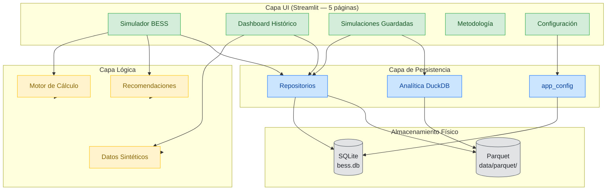
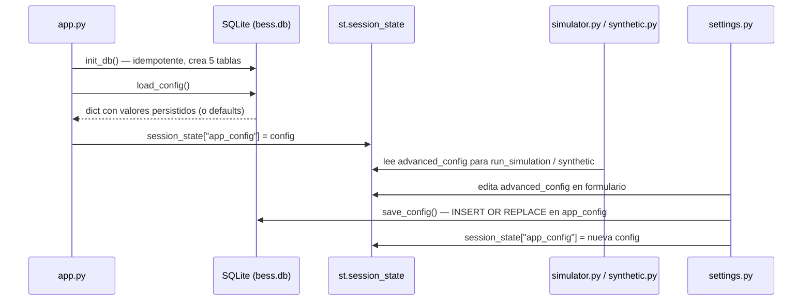
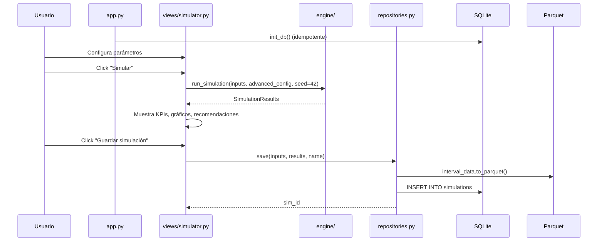

# Arquitectura General — BESS Simulator

---

## 1. Visión General

El BESS Simulator es una herramienta empresarial interna para el análisis de sensibilidad de inversiones en sistemas de almacenamiento de energía por baterías (BESS). Permite simular el retorno de la inversión, visualizar indicadores técnico-económicos y comparar escenarios.

### Stack tecnológico

| Componente | Tecnología | Propósito |
|------------|-----------|-----------|
| **Lenguaje** | Python ≥ 3.11 | Motor de cálculo y UI |
| **UI** | Streamlit ≥ 1.30 | Interfaz web interactiva |
| **Gráficos** | Plotly ≥ 5.18 | Visualizaciones interactivas |
| **Datos** | Pandas ≥ 2.0 + NumPy ≥ 1.24 | DataFrames y cálculo vectorizado |
| **DB catálogo** | SQLite 3 (stdlib) | Metadatos, KPIs de simulaciones y configuración de la aplicación |
| **Series temporales** | Parquet (PyArrow ≥ 14.0) | Almacenamiento columnar comprimido |
| **Analítica** | DuckDB ≥ 0.10 | Consultas SQL sobre Parquet |
| **Export** | openpyxl ≥ 3.1 | Exportación a Excel |

---

## 2. Estructura de Paquetes

```
src/bess_simulator/
├── config.py                       # Constantes, rangos, valores por defecto
│                                   #   CALENDAR_AGING_RATE, HISTORICAL_CYCLE_DEGRADATION,
│                                   #   RTE_ANNUAL_DECAY
├── models/                         # Modelos de datos (dataclasses)
│   ├── parameters.py               #   SimulationInputs (4 sub-dataclasses)
│   └── results.py                  #   SimulationResults, SensitivityResult
├── engine/                         # Motor de cálculo
│   ├── simulation.py               #   run_simulation(inputs, advanced_config) — 15 min
│   ├── sensitivity.py              #   run_sensitivity_matrix() — CAPEX × Precio
│   └── validation.py               #   Validación de parámetros
├── data/                           # Generación y exportación de datos
│   ├── synthetic.py                #   Modelo OMIE (hist + futuro) con cfg dict
│   └── export.py                   #   Export a Excel y CSV
├── recommendations/                # Motor de recomendaciones
│   ├── __init__.py                 #   generate_full_recommendation(advanced_config)
│   ├── decision_tree.py            #   Evaluación ROI + Degradación
│   ├── sub_recommendations.py      #   5 recomendaciones por parámetro
│   └── alarms.py                   #   Alarmas de valores fuera de rango
├── storage/                        # Capa de persistencia
│   ├── paths.py                    #   Resolución de rutas (dev vs portable)
│   ├── schema.py                   #   Esquema SQLite (5 tablas) + init_db()
│   ├── repositories.py             #   SimulationRepository, DashboardRepository,
│   │                               #   SensitivityRepository
│   ├── app_config.py               #   load_config / save_config / reset_config
│   │                               #   DEFAULT_ADVANCED_CONFIG (~50 parámetros)
│   └── analytics.py                #   Consultas DuckDB sobre Parquet
└── ui/                             # Interfaz de usuario (Streamlit)
    ├── app.py                      #   Entry point: init_db + load_config + navegación 5 páginas
    ├── components/                  #   Componentes reutilizables
    │   ├── charts.py               #     11 funciones de gráficos Plotly
    │   ├── input_forms.py          #     Formularios de entrada
    │   ├── kpi_cards.py            #     Tarjetas ROI y VAN
    │   ├── recommendations_panel.py #    Panel de recomendaciones
    │   └── sticky_header.py        #     Cabecera fija de página
    └── views/                       #   Páginas de la aplicación
        ├── simulator.py            #     Módulo 1: Simulador BESS
        ├── dashboard.py            #     Módulo 2: Dashboard Histórico
        ├── saved_simulations.py    #     Módulo 3: Simulaciones Guardadas
        ├── methodology.py          #     Módulo 4: Metodología
        └── settings.py             #     Módulo 5: Configuración avanzada
```

---

## 3. Diagrama de Capas



---

## 4. Flujo de Configuración

Al arrancar, `app.py` inicializa el sistema y carga la configuración avanzada en `st.session_state`. Las vistas de simulación, síntesis de datos y recomendaciones leen desde ese estado. La página de Configuración permite editar y persistir cambios.



---

## 5. Flujo de Ejecución (Simulación)



---

## 6. Principios de Diseño

| Principio | Aplicación |
|-----------|-----------|
| **Separación de capas** | UI → Lógica → Storage. Ninguna capa accede directamente a la inferior saltándose la intermedia |
| **Repository pattern** | El acceso a datos se abstrae tras `SimulationRepository`, `DashboardRepository`, `SensitivityRepository` |
| **File-based storage** | Sin dependencia de servidores externos (SQLite + Parquet). Portable y empaquetable |
| **Guardado explícito** | El usuario decide cuándo persistir. No se guardan simulaciones automáticamente |
| **Idempotencia** | `init_db()` puede ejecutarse múltiples veces sin efecto secundario |
| **Inmutabilidad de simulaciones** | Una vez guardada, una simulación no se modifica (solo se elimina o se crea otra) |
| **DuckDB como vista** | DuckDB no almacena datos. Lee Parquet directamente para queries analíticos |
| **Parámetros configurables** | `DEFAULT_ADVANCED_CONFIG` (~50 parámetros en 6 grupos) controla el modelo sin tocar código. Los cambios se persisten en la tabla `app_config` de SQLite |

---

## 7. Resolución Temporal

| Contexto | Resolución | Filas típicas |
|----------|-----------|---------------|
| **Motor de simulación** | 15 minutos | ~525.600 (15 años × 365 × 96) |
| **Dashboard sintético** | 15 minutos | ~70.080 (2 años × 365 × 96) |
| **Yearly summary** | Anual | 10–15 |
| **Sensibilidad** | Celda de matriz | 35 (7 precios × 5 CAPEX) |

---

## 8. Empaquetado y Distribución

```
dist/bess-simulator/
├── python/                # Python 3.11 embebido + pip + site-packages
├── src/                   # Código fuente de la aplicación
├── .streamlit/
│   └── config.toml        # Tema oscuro, toolbar mínima
├── data/                  # Directorio de datos (creado en primera ejecución)
│   ├── bess.db
│   └── parquet/
└── installer/
    ├── launch_bess.bat    # Doble clic → abre Streamlit en el navegador
    ├── build_package.py   # Automatiza la construcción del paquete
    ├── requirements.txt
    └── bess_installer.iss # Inno Setup (opcional) → genera .exe instalador
```

| Modo | Variable `BESS_PORTABLE` | Ruta de datos |
|------|-------------------------|---------------|
| **Desarrollo** | No definida | `{project_root}/data/` |
| **Producción** | `1` | `{directorio_del_exe}/data/` |
