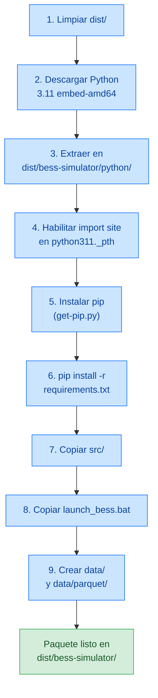

# Empaquetado y Distribución — BESS Simulator

> Versión: 0.1.0 | Última actualización: 2026-03-15

---

## 1. Estrategia de Empaquetado

La aplicación se distribuye como un directorio autocontenido con Python embebido. No requiere que el usuario tenga Python instalado en su máquina.

### Alternativas evaluadas

| Enfoque | Veredicto | Razón |
|---------|-----------|-------|
| **Python embebido + pip** | **Elegido** | Más fiable con Streamlit. Control total sobre dependencias |
| PyInstaller | Descartado | Problemas conocidos con Streamlit (archivos estáticos, Jinja, WebSocket) |
| cx_Freeze | Descartado | Mismos problemas que PyInstaller con frameworks web |
| Nuitka | Descartado | Compilación AOT no compatible con la arquitectura de Streamlit |
| Docker | Descartado | Overhead innecesario para herramienta de escritorio interna |

---

## 2. Estructura del Paquete Distribuible

```
dist/bess-simulator/
├── python/                         # Python 3.11 embebido
│   ├── python.exe                  # Intérprete
│   ├── python311.dll               # Runtime
│   ├── python311._pth              # Path config (import site habilitado)
│   ├── Lib/
│   │   └── site-packages/          # Dependencias instaladas con pip
│   │       ├── streamlit/
│   │       ├── pandas/
│   │       ├── numpy/
│   │       ├── plotly/
│   │       ├── pyarrow/
│   │       ├── duckdb/
│   │       └── ...
│   └── Scripts/
│       └── streamlit.exe
├── src/                            # Código fuente de la aplicación
│   └── bess_simulator/
│       ├── config.py
│       ├── models/
│       ├── engine/
│       ├── data/
│       ├── recommendations/
│       ├── storage/
│       └── ui/
├── data/                           # Datos persistentes (creado en primera ejecución)
│   ├── bess.db
│   └── parquet/
└── launch_bess.bat                 # Punto de entrada
```

### Tamaño estimado

| Componente | Tamaño aprox. |
|-----------|---------------|
| Python embebido | ~15 MB |
| site-packages (todas las deps) | ~300-400 MB |
| Código fuente | ~200 KB |
| **Total** | **~350-450 MB** |

---

## 3. Proceso de Construcción

**Script:** `installer/build_package.py`



### Ejecución

```bash
python installer/build_package.py
```

### Requisitos del entorno de build

| Requisito | Versión | Propósito |
|-----------|---------|-----------|
| Python | ≥ 3.11 | Ejecutar el script de build |
| Conexión a internet | — | Descargar Python embebido + dependencias |
| Espacio en disco | ~1 GB | Para build + paquete final |

---

## 4. Launcher

**Archivo:** `installer/launch_bess.bat`

```bat
@echo off
setlocal
set "BESS_ROOT=%~dp0"
set "BESS_PORTABLE=1"
set "PYTHONPATH=%BESS_ROOT%src"
"%BESS_ROOT%python\python.exe" -m streamlit run "%BESS_ROOT%src\bess_simulator\ui\app.py" ^
    --server.headless true ^
    --server.port 8501 ^
    --browser.gatherUsageStats false ^
    --theme.primaryColor "#3498db"
endlocal
```

| Variable | Propósito |
|----------|-----------|
| `BESS_ROOT` | Directorio donde reside el .bat (base para rutas relativas) |
| `BESS_PORTABLE=1` | Indica a `paths.py` que use la ruta local para datos |
| `PYTHONPATH` | Permite que Python encuentre el paquete `bess_simulator` |

### Comportamiento

1. El usuario hace doble clic en `launch_bess.bat`
2. Se abre una ventana de terminal (cmd)
3. Streamlit arranca en modo headless en el puerto 8501
4. El navegador se abre automáticamente en `http://localhost:8501`
5. La terminal permanece abierta (cerrarla detiene la aplicación)

---

## 5. Instalador (Inno Setup)

**Archivo:** `installer/bess_installer.iss`

### Requisitos

- [Inno Setup 6.x](https://jrsoftware.org/isinfo.php) instalado en la máquina de build
- Paquete previamente construido en `dist/bess-simulator/`

### Compilación

1. Ejecutar `python installer/build_package.py`
2. Abrir `installer/bess_installer.iss` con Inno Setup Compiler
3. Compilar → genera `dist/BessSimulatorSetup.exe`

### Características del instalador

| Característica | Configuración |
|---------------|---------------|
| Nombre | BESS Simulator |
| Directorio por defecto | `C:\Program Files\BessSimulator\` |
| Privilegios | `lowest` (no requiere admin) |
| Compresión | LZMA2 + sólida |
| Acceso directo escritorio | Opcional (checkbox en instalación) |
| Acceso directo menú Inicio | Sí |
| Post-instalación | Opción de lanzar la app inmediatamente |

### Desinstalación

| Elemento | Comportamiento |
|----------|---------------|
| `python/` | Se elimina |
| `src/` | Se elimina |
| `launch_bess.bat` | Se elimina |
| `data/` | **Se preserva** (simulaciones guardadas del usuario) |

---

## 6. Modos de Ejecución

| Modo | Cómo ejecutar | `BESS_PORTABLE` | Ruta de datos |
|------|---------------|-----------------|---------------|
| **Desarrollo** | `streamlit run src/bess_simulator/ui/app.py` | No definida | `{project_root}/data/` |
| **Portable (zip)** | Descomprimir + `launch_bess.bat` | `1` | `{directorio_bat}/data/` |
| **Instalado** | Acceso directo → `launch_bess.bat` | `1` | `{install_dir}/data/` |

### Detección de rutas (paths.py)

```python
def get_data_dir() -> Path:
    if os.environ.get("BESS_PORTABLE") == "1":
        # Sube 3 niveles: storage/ → bess_simulator/ → src/ → raíz
        base = Path(__file__).resolve().parents[3]
    else:
        # Sube 4 niveles: storage/ → bess_simulator/ → src/ → practica-1/
        base = Path(__file__).resolve().parents[4]
    data_dir = base / "data"
    data_dir.mkdir(parents=True, exist_ok=True)
    return data_dir
```

---

## 7. Distribución sin instalador

Para entornos donde no se puede ejecutar un instalador `.exe`, se puede distribuir directamente como archivo comprimido:

1. Ejecutar `python installer/build_package.py`
2. Comprimir `dist/bess-simulator/` como `.zip`
3. Distribuir el `.zip`
4. El usuario descomprime y ejecuta `launch_bess.bat`

---

## 8. Actualizaciones

Para actualizar la aplicación en máquinas ya instaladas:

| Método | Pasos | Preserva datos |
|--------|-------|----------------|
| **Reinstalar** | Desinstalar + instalar nueva versión | Sí (`data/` se preserva) |
| **Sobreescribir** | Copiar nuevos `src/` y `python/` sobre los existentes | Sí |
| **Portable** | Reemplazar el directorio completo, conservar `data/` | Manual |

### Migraciones de esquema SQLite

La tabla `_schema_version` permite detectar la versión del esquema y aplicar migraciones incrementales en futuras versiones. El flujo previsto:

```python
def init_db(db_path):
    # Crea tablas si no existen
    # Lee schema_version
    # Si version < SCHEMA_VERSION: aplica migraciones secuenciales
```
