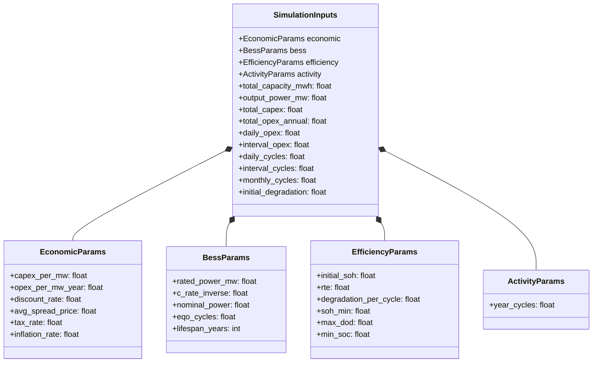
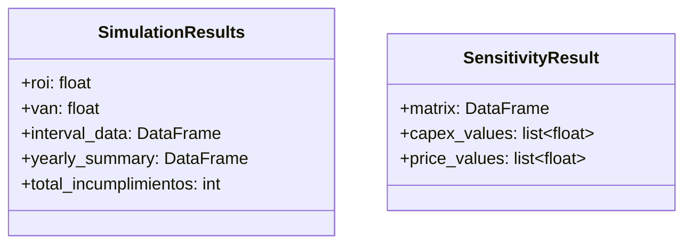
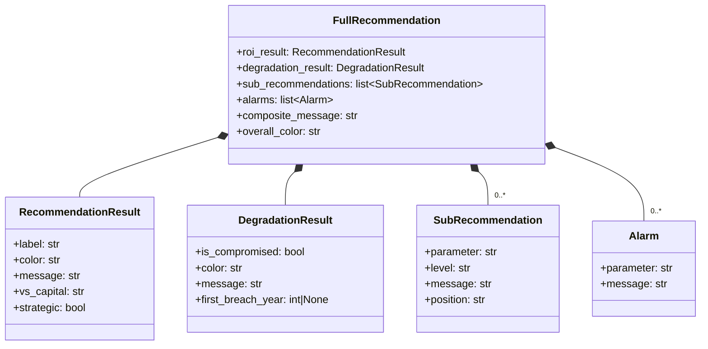
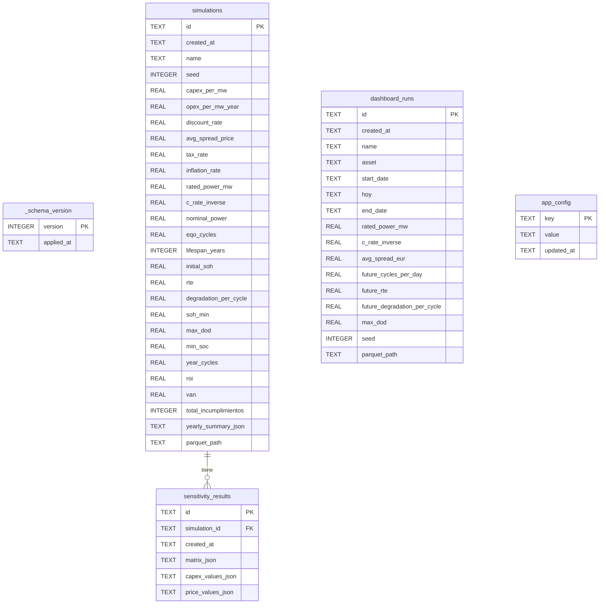

# Modelo de Datos — BESS Simulator

---

## 1. Modelos de Dominio (Dataclasses)

### 1.1 Parámetros de Entrada



**Archivo fuente:** `src/bess_simulator/models/parameters.py`

Todos los parámetros numéricos se validan contra rangos definidos en `config.py` al instanciar las dataclasses (`__post_init__`).

---

### 1.2 Resultados de Simulación



**Archivo fuente:** `src/bess_simulator/models/results.py`

---

### 1.3 Recomendaciones



**Archivo fuente:** `src/bess_simulator/recommendations/`

La función de entrada es `generate_full_recommendation(inputs, results, advanced_config)`. Los umbrales que controlan las clasificaciones (ROI alto, RTE aceptable, vida útil mínima, etc.) se leen del `advanced_config` en lugar de estar codificados.

> **Especificación detallada del motor:** ver
> [motor-recomendaciones.md](motor-recomendaciones.md), que documenta la lógica
> de negocio (ROI frente al coste del capital, dimensión estratégica, posición
> margen/límite de cada parámetro, cruce ROI×SoH) y la redacción en lenguaje
> natural del mensaje compuesto.

---

## 2. Esquemas de DataFrames

### 2.1 interval_data (Simulación — 15 min)

Generado por `engine/simulation.py`. Resolución: cada 15 minutos durante toda la vida útil.

| Columna | Tipo | Unidad | Descripción |
|---------|------|--------|-------------|
| `timestamp` | datetime64 | — | Marca temporal (15 min) |
| `available_capacity` | float64 | MWh | Capacidad energética disponible tras degradación |
| `period_degradation` | float64 | ratio | Degradación acumulada desde inicio (0.0 → 1.0) |
| `cycle_number` | float64 | ciclos | Ciclos equivalentes en el intervalo |
| `rte` | float64 | ratio | Round Trip Efficiency del intervalo |
| `sold_energy` | float64 | MWh | Energía vendida |
| `spread_price` | float64 | €/MWh | Precio SPREAD de venta |
| `income` | float64 | € | Ingresos = sold_energy × spread_price |
| `interval_opex` | float64 | € | OPEX del intervalo |
| `cash_flow` | float64 | € | income - interval_opex |
| `discounted_cf` | float64 | € | Cash flow descontado |
| `accumulated_dcf` | float64 | € | Flujo acumulado descontado (inicia en -CAPEX) |

**Volumen:** ~525.600 filas × 12 columnas para 15 años (≈ 2–3 MB en Parquet con Snappy)

---

### 2.2 yearly_summary (Simulación — Anual)

Agregación anual del `interval_data`. Generado por `engine/simulation.py`.

| Columna | Tipo | Unidad | Descripción |
|---------|------|--------|-------------|
| `year` | int64 | — | Año (0-indexado) |
| `total_income` | float64 | € | Ingresos totales del año |
| `total_opex` | float64 | € | OPEX total del año |
| `net_cash_flow` | float64 | € | Flujo neto anual |
| `accumulated_dcf` | float64 | € | DCF acumulado al final del año |
| `avg_degradation` | float64 | ratio | Degradación promedio |
| `avg_rte` | float64 | ratio | RTE promedio |
| `soh_compliance` | bool | — | ¿Cumple SoH mínimo todo el año? |
| `soh_end` | float64 | ratio | SoH al final del año (1.0 - max_degradation) |

**Volumen:** 10–15 filas × 9 columnas. Se serializa como JSON en la columna `yearly_summary_json` de la tabla `simulations`.

---

### 2.3 Dashboard Dataset (Datos Sintéticos — 15 min)

Generado por `data/synthetic.py`. Combina un régimen histórico (modelo OMIE con parámetros del `cfg` dict) con una proyección paramétrica controlada por el usuario.

| Columna | Tipo | Unidad | Descripción |
|---------|------|--------|-------------|
| `timestamp` | datetime64 | — | Marca temporal (15 min) |
| `income` | float64 | € | Ingresos = energy × spread |
| `capture_price` | float64 | €/MWh | Precio de venta capturado |
| `average_market_price` | float64 | €/MWh | Precio medio de mercado OMIE |
| `energy_sold_mwh` | float64 | MWh | Energía vendida |
| `soh` | float64 | ratio | State of Health (0.0 → 1.0) |
| `cycles` | float64 | FEC | Ciclos equivalentes parciales |
| `temperature` | float64 | °C | Temperatura de operación |
| `rte` | float64 | ratio | Round Trip Efficiency |
| `is_forecast` | bool | — | True = proyección, False = histórico |

**Volumen:** ~70.080 filas × 10 columnas para 2 años (≈ 200 KB en Parquet)

---

### 2.4 Sensitivity Matrix

Generado por `engine/sensitivity.py`. Matriz ROI para combinaciones de CAPEX y precio.

| Eje | Contenido | Valores por defecto |
|-----|-----------|---------------------|
| **Filas** (index) | Precios SPREAD (€/MWh) | 7 valores centrados en avg_spread_price ± 30% |
| **Columnas** | CAPEX (€/MW) | 5 valores centrados en capex_per_mw ± 20% |
| **Celdas** | ROI (ratio) | Resultado de `run_simulation()` para cada combinación |

---

## 3. Esquema de Base de Datos (SQLite)

**Archivo fuente:** `src/bess_simulator/storage/schema.py`
**Ubicación en disco:** `data/bess.db`



### Decisiones de diseño

| Decisión | Justificación |
|----------|---------------|
| `id` como UUID hex (32 chars) | Evita colisiones sin auto-increment. Sirve como nombre de archivo Parquet |
| 18 params aplanados en `simulations` | Permite filtrar y buscar por parámetros sin deserializar JSON |
| `yearly_summary` como JSON en SQLite | Solo 10–15 filas — no justifica un archivo Parquet separado |
| `sensitivity_results.matrix_json` | Formato `split` de pandas (index + columns + data) para preservar ejes |
| `app_config` como clave-valor JSON | Permite añadir/eliminar parámetros de configuración sin migraciones de esquema |
| `parquet_path` como ruta relativa | Portabilidad: funciona si se mueve el directorio completo |
| WAL mode activado | Mejor rendimiento en lectura concurrente (múltiples tabs de Streamlit) |
| Foreign keys activadas | Integridad referencial: eliminar simulación → elimina sensibilidad (CASCADE) |

---

## 4. Configuración Avanzada (app_config)

**Archivo fuente:** `src/bess_simulator/storage/app_config.py`

La tabla `app_config` almacena overrides del `DEFAULT_ADVANCED_CONFIG`. Los valores que no han sido editados por el usuario no tienen fila en la tabla; en su lugar se usan los defaults definidos en Python.

```python
# Funciones públicas
load_config(db_path)   # Merge de defaults + overrides persistidos → dict
save_config(db_path, config)   # INSERT OR REPLACE para cada clave modificada
reset_config(db_path)  # DELETE FROM app_config → vuelve a defaults
```

### Grupos de parámetros en DEFAULT_ADVANCED_CONFIG (~50 parámetros)

| Grupo | Parámetros representativos |
|-------|---------------------------|
| **Degradación y eficiencia** | `calendar_aging_rate`, `historical_cycle_degradation`, `rte_annual_decay`, `rte_base_historical`, `rte_floor`, `rte_ceiling` |
| **Modelo de precios OMIE** | `omie_base_price`, amplitudes de valle/pico/solar/tarde, factores día-semana, factores estacionales (array 12 meses), ruido diario e intradía, floor/ceiling |
| **Ventanas de arbitraje** | `charge_start_hour`, `charge_end_hour`, `discharge_am_start/end_hour`, `discharge_pm_start/end_hour` |
| **Operación histórica** | `hist_utilization_min/max`, `future_utilization_min/max` |
| **Variabilidad estocástica** | `sim_cycle_variation`, `sim_rte_noise_std`, `sim_price_floor_factor`, `sim_price_range_factor` |
| **Umbrales de recomendación** | `rec_roi_high_threshold`, `rec_roi_diversify_band`, `rec_discount_rate_ok`, `rec_opex_ok/warning`, `rec_rte_ok/warning`, `rec_lifespan_ok/warning`, `rec_price_ok/warning` |

---

## 5. Almacenamiento en Parquet

**Ubicación:** `data/parquet/`

### Convención de nombres

| Tipo | Patrón | Ejemplo |
|------|--------|---------|
| Simulación | `sim_{uuid}.parquet` | `sim_a3f2c9b1e4d5.parquet` |
| Dashboard | `dash_{uuid}.parquet` | `dash_7b2e1f8c3a4d.parquet` |

### Configuración

| Propiedad | Valor |
|-----------|-------|
| Engine | PyArrow |
| Compresión | Snappy (balance velocidad/tamaño) |
| Formato | columnar (un grupo de filas) |

### Tamaños estimados

| Dataset | Filas | Columnas | CSV | Parquet (Snappy) | Ratio |
|---------|-------|----------|-----|-------------------|-------|
| interval_data (15 años) | 525.600 | 12 | ~50 MB | ~2–3 MB | ~20:1 |
| Dashboard (2 años) | 70.080 | 10 | ~5 MB | ~200 KB | ~25:1 |

---

## 6. Capa Analítica (DuckDB)

DuckDB se usa como motor de consultas SQL **read-only** sobre los archivos Parquet existentes. No almacena datos propios.

**Archivo fuente:** `src/bess_simulator/storage/analytics.py`

### Funciones disponibles

| Función | Propósito | SQL equivalente |
|---------|-----------|-----------------|
| `compare_simulations(sim_ids)` | Combinar datos de varias simulaciones | `SELECT * FROM read_parquet('sim_A') UNION ALL SELECT * FROM read_parquet('sim_B')` |
| `query_interval_data(sim_id, sql)` | Consulta ad-hoc sobre una simulación | SQL libre con `{table}` como placeholder |
| `aggregate_dashboard_kpis(run_id)` | KPIs agregados de un dataset | `SELECT SUM(income), AVG(soh), ... FROM read_parquet(...)` |

### Ejemplo de uso

```python
from bess_simulator.storage.analytics import query_interval_data

df = query_interval_data(
    sim_id="a3f2c9b1e4d5",
    sql="SELECT AVG(rte), MIN(available_capacity) FROM {table} WHERE spread_price > 60",
    parquet_dir=get_parquet_dir(),
)
```

---

## 7. Repository Pattern

**Archivo fuente:** `src/bess_simulator/storage/repositories.py`

### SimulationRepository

| Método | Entrada | Salida | Descripción |
|--------|---------|--------|-------------|
| `save()` | `SimulationInputs`, `SimulationResults`, `name?`, `seed?` | `str` (id) | Escribe Parquet + inserta en SQLite |
| `list_all()` | — | `list[dict]` | SELECT ligero (id, name, fecha, ROI, VAN) |
| `get_metadata()` | `sim_id` | `dict` | Todos los campos de la fila SQLite |
| `load_interval_data()` | `sim_id` | `DataFrame` | Lee Parquet asociado |
| `load_yearly_summary()` | `sim_id` | `DataFrame` | Deserializa JSON de SQLite |
| `load_inputs()` | `sim_id` | `SimulationInputs` | Reconstruye dataclass desde campos aplanados |
| `delete()` | `sim_id` | — | Elimina fila + archivo Parquet |

### DashboardRepository

| Método | Entrada | Salida | Descripción |
|--------|---------|--------|-------------|
| `save()` | `params: dict`, `df: DataFrame`, `name?` | `str` (id) | Escribe Parquet + inserta en SQLite |
| `list_all()` | — | `list[dict]` | SELECT ligero |
| `load_dataset()` | `run_id` | `DataFrame` | Lee Parquet asociado |
| `delete()` | `run_id` | — | Elimina fila + archivo Parquet |

### SensitivityRepository

| Método | Entrada | Salida | Descripción |
|--------|---------|--------|-------------|
| `save()` | `simulation_id`, `SensitivityResult` | `str` (id) | Serializa a JSON en SQLite |
| `load()` | `simulation_id` | `SensitivityResult \| None` | Última sensibilidad de esa simulación |
