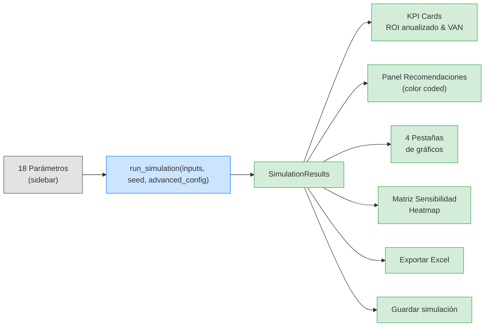
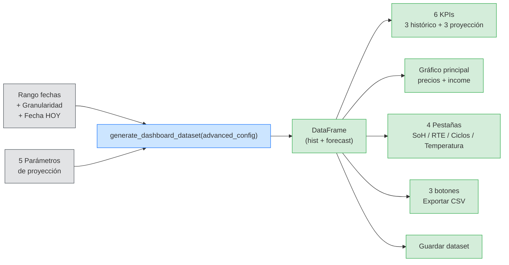
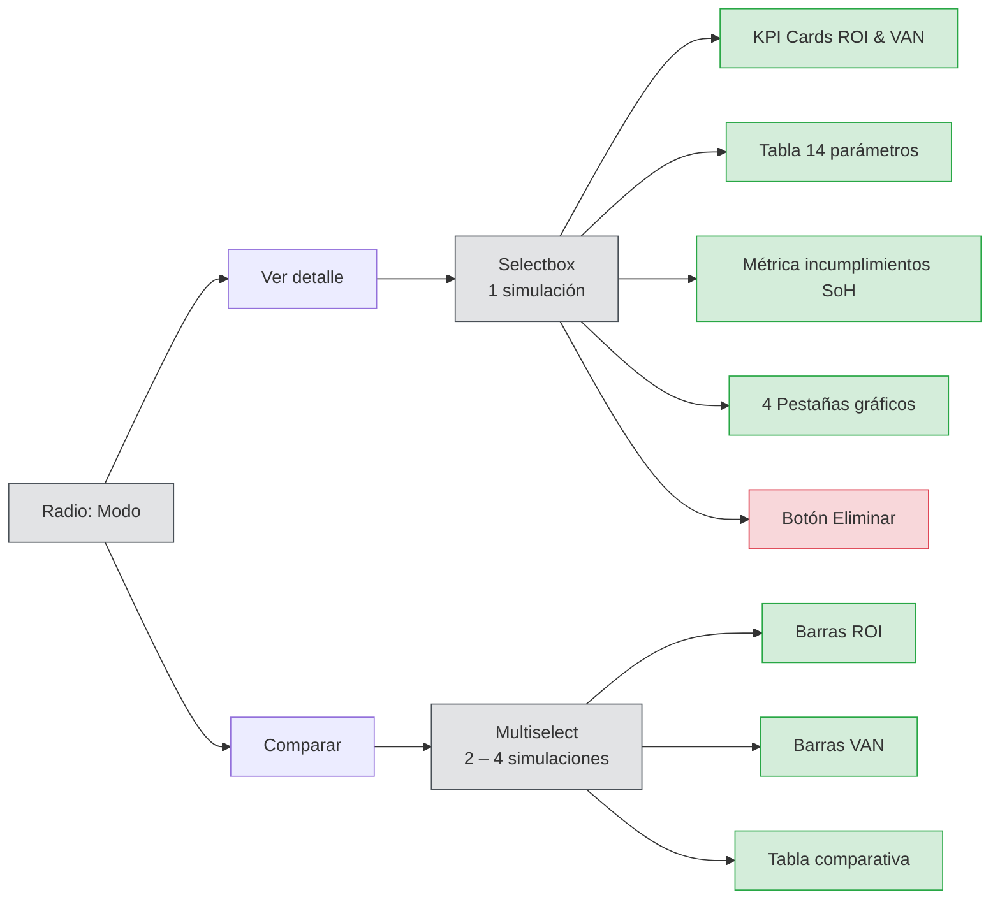
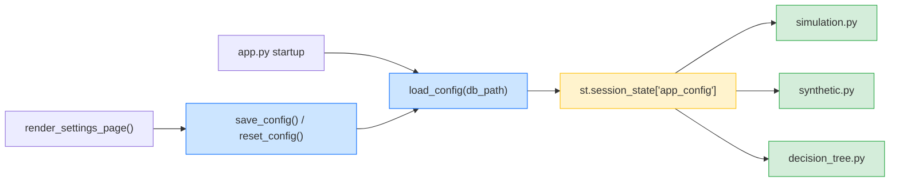

# Módulos Funcionales — BESS Simulator

---

## Página 1: Simulador BESS

### Propósito

Análisis de sensibilidad de la inversión en una instalación BESS. El usuario configura parámetros económicos, técnicos y de eficiencia en el sidebar, y el motor calcula ROI anualizado, VAN (con -CAPEX incluido), flujos de caja y degradación a lo largo de la vida útil.

### Flujo funcional



### Parámetros de entrada (18 en 4 grupos)

| Grupo | Parámetro | Tipo de control | Rango |
|-------|-----------|-----------------|-------|
| **Económicos** | CAPEX (€/MW) | number_input | 300K – 1M |
| | OPEX (€/MW/año) | number_input | 11K – 22.5K |
| | Tasa de descuento | slider | 5% – 10% |
| | Precio SPREAD medio (€/MWh) | slider | 20 – 100 |
| **Batería BESS** | Potencia instalada (MW) | number_input | 1 – 200 |
| | 1/C-Rate (MWh/MW) | slider | 1 – 8 |
| | Ciclos vida útil | number_input | 6 000 – 8 000 |
| | Vida útil (años) | slider | 10 – 25 |
| **Eficiencia** | SoH inicial (%) | slider | 95% – 100% |
| | RTE (%) | slider | 80% – 90% |
| | Degradación (%/ciclo) | select_slider | 0.005% – 0.020% |
| | SoH mínimo garantizado (%) | slider | 70% – 80% |
| | DoD máximo (%) | slider | 80% – 95% |
| **Actividad** | Ciclos anuales | slider | 300 – 1 000 |

El sidebar también muestra tres **parámetros derivados** (solo lectura): capacidad total MWh, CAPEX total €, OPEX total anual €.

### Motor de simulación

**Archivo:** `src/bess_simulator/engine/simulation.py`

Firma: `run_simulation(inputs: SimulationInputs, seed: int | None, advanced_config: dict | None) -> SimulationResults`

Genera arrays de resolución 15 minutos para toda la vida útil (hasta 525 600 intervalos).

| Fórmula | Descripción |
|---------|-------------|
| `Capacidad₀ = Potencia × C-Rate × SoH_inicial` | Capacidad efectiva inicial |
| `Degradación_t = calendar_loss_t + Σ(degradación_ciclo × ciclos_diarios)` | Combinación de envejecimiento calendario y cíclico |
| `Capacidad_t = (1 − Degradación_t) × Capacidad₀` | Capacidad disponible en cada día |
| `Energía = Capacidad_t × ciclos_intervalo × RTE × DoD_máx` | Sin factor 0.25h adicional |
| `Income = Energía × precio_SPREAD` | Ingresos por intervalo |
| `DCF_t = CashFlow_t / (1 + tasa_descuento)^(t/365)` | Flujo descontado |
| `VAN = −CAPEX + Σ DCF_t` | VAN incluye la inversión inicial |
| `ROI = (1 + DCF_acumulado_final / CAPEX)^(1/vida_útil) − 1` | ROI anualizado comparable con tasa de descuento |

Parámetros estocásticos (todos leen de `advanced_config`):

| Variable | Distribución | Clave en advanced_config |
|----------|-------------|--------------------------|
| Variación ciclos | Uniforme [0, +40% base] | `sim_cycle_variation` |
| Ruido RTE | Normal(0, σ) | `sim_rte_noise_std` |
| Precio SPREAD | Uniforme [70% base, +100% base] | `sim_price_floor_factor`, `sim_price_range_factor` |

El decaimiento de RTE a lo largo del tiempo lee `rte_annual_decay` de `advanced_config`.

### Motor de sensibilidad

**Archivo:** `src/bess_simulator/engine/sensitivity.py`

Ejecuta `run_simulation()` para cada combinación de una matriz 7×5:
- **Filas (7):** valores de precio SPREAD a ±30% del base
- **Columnas (5):** valores de CAPEX a ±20% del base
- **Celdas:** ROI resultante

### Motor de recomendaciones

**Archivos:** `src/bess_simulator/recommendations/`

> **Especificación normativa completa:** [motor-recomendaciones.md](motor-recomendaciones.md).
> Componente core: incluye la lógica de negocio (ROI vs coste del capital,
> dimensión estratégica, posición margen/límite, cruce ROI×SoH, año de
> incumplimiento del SoH) y la redacción en lenguaje natural.

Cadena de evaluación:

```
Alarmas operacionales → Evaluación ROI → Evaluación Degradación
→ 5 Sub-recomendaciones por parámetro → Mensaje compuesto (narrador en prosa)
```

Principios: **informar, no desaconsejar** (sin "no recomendado"); **lenguaje
natural** (prosa con conectores, no `+`); **umbrales 100% configurables**.

| Evaluación | Niveles | Colores | Atributo clave |
|-----------|---------|---------|----------------|
| ROI vs tasa descuento (coste del capital) | 6 tramos (rentable → no rentable) | verde / amarillo / azul | `vs_capital`, `strategic` |
| Degradación vs (1 − SoH_mín) | 2 niveles + año de incumplimiento | verde / azul | `first_breach_year` |
| Tasa de descuento | óptimo / margen / límite | neutro / amarillo / azul | `position` |
| OPEX | óptimo / margen / límite | neutro / amarillo / azul | `position` |
| RTE | óptimo / margen / límite | neutro / amarillo / azul | `position` |
| Vida útil | óptimo / margen / límite | neutro / amarillo / azul | `position` |
| Precio retribución | óptimo / margen / límite | neutro / amarillo / azul | `position` |

El color global se resuelve con prioridad `azul > amarillo > verde`. El **azul**
("A valorar por el operador") es informativo y sustituye al antiguo rojo
prohibitivo. Los umbrales de todas las evaluaciones se leen de `advanced_config`
(claves `rec_*`) y son editables en Configuración del Modelo.

### Visualizaciones

| Pestaña | Gráfico | Caption |
|---------|---------|---------|
| Ingresos/Costes | Barras agrupadas income vs OPEX por año | "Comparación anual entre ingresos por venta de energía y costes operativos" |
| SoH | Línea SoH + umbral mínimo punteado | "La línea punteada indica el SoH mínimo garantizado" |
| Cash Flow | Línea DCF acumulado (inicia en −CAPEX) | "Inicia en −CAPEX y crece con los ingresos netos" |
| Degradación/RTE | Doble eje: degradación acumulada + RTE medio | "Tendencia descendente esperada" |
| Sensibilidad | Heatmap CAPEX × Precio → ROI | "Cada celda muestra el ROI resultante de variar CAPEX y precio SPREAD" |

### Exportaciones

| Formato | Contenido |
|---------|-----------|
| **Excel** | Hoja "Inputs" (18 params), "Resumen Anual" (yearly_summary), "Outputs" (ROI, VAN, Incumplimientos) |
| **SQLite + Parquet** | Botón "Guardar simulación" → `SimulationRepository.save()` |

---

## Página 2: Dashboard Histórico

### Propósito

Cuadro de mando con datos históricos sintéticos (modelado experto OMIE) y proyección futura parametrizable. Visualiza indicadores técnico-económicos del desempeño de una instalación BESS.

### Flujo funcional



### Controles de entrada

| Control | Tipo | Valores |
|---------|------|---------|
| Rango de operación | date_input (rango) | 2020-01-01 → 2030-12-31 |
| Granularidad | radio | Daily / 15-min |
| Fecha HOY (frontera hist/proyección) | date_input | entre start y end |
| Spread medio (€/MWh) | slider | 20 – 80 |
| Ciclos equiv./día | slider | 0.5 – 3.0 |
| RTE esperado (%) | slider | 80% – 92% |
| Degradación/ciclo (%) | select_slider | 0.005% – 0.020% |
| DoD máximo (%) | slider | 80% – 95% |

### Generación de datos sintéticos

**Archivo:** `src/bess_simulator/data/synthetic.py`

Firma: `generate_dashboard_dataset(..., advanced_config: dict) -> pd.DataFrame`

Dos regímenes separados por la fecha HOY:

| Régimen | Periodo | Fuente de datos |
|---------|---------|-----------------|
| **Histórico** | start_date → HOY | Modelado experto OMIE: curva diaria × factores semanales × factores estacionales + ruido. Los parámetros del modelo leen de `advanced_config` |
| **Proyección** | HOY → end_date | Parámetros del usuario (spread, ciclos/día, RTE, degradación, DoD) sobre precios OMIE escalados |

#### Modelo de precios OMIE

```
precio(t) = base_diaria(hora) × factor_semanal(día) × factor_estacional(mes) + ruido
```

Todos los valores por defecto; todos configurables en `advanced_config` (claves `omie_*`):

| Componente | Clave | Valor por defecto |
|-----------|-------|-------------------|
| Precio base | `omie_base_price` | 55 €/MWh |
| Valle nocturno (04:00) | `omie_valley_amplitude` | −10 €/MWh |
| Pico mañana (09:00) | `omie_morning_peak_amplitude` | +30 €/MWh |
| Caída solar (13:30) | `omie_solar_dip_amplitude` | −15 €/MWh |
| Pico tarde (20:00) | `omie_evening_peak_amplitude` | +38 €/MWh |
| Factor sábado | `omie_saturday_factor` | 0.82 |
| Factor domingo | `omie_sunday_factor` | 0.78 |
| Factores estacionales (12) | `omie_seasonal_factors` | Ene 1.12 … Dic 1.15 |
| Ruido diario | `omie_daily_noise_std` | σ = 5 €/MWh |
| Ruido intradiario | `omie_intraday_noise_std` | σ = 2 €/MWh |
| Precio mínimo clip | `omie_price_floor` | 20 €/MWh |
| Precio máximo clip | `omie_price_ceiling` | 150 €/MWh |

#### Ventanas de arbitraje

| Ventana | Horario por defecto | Claves en advanced_config |
|---------|---------------------|---------------------------|
| Carga | 02:00 – 06:00 | `charge_start_hour`, `charge_end_hour` |
| Descarga AM | 08:00 – 10:00 | `discharge_am_start_hour`, `discharge_am_end_hour` |
| Descarga PM | 19:00 – 21:00 | `discharge_pm_start_hour`, `discharge_pm_end_hour` |

#### Utilización en ventanas de descarga

| Régimen | Rango | Claves |
|---------|-------|--------|
| Histórico | 70% – 92% | `hist_utilization_min`, `hist_utilization_max` |
| Proyección | 75% – 90% | `future_utilization_min`, `future_utilization_max` |

### KPIs del dashboard (6)

| KPI | Régimen | Cálculo |
|-----|---------|---------|
| Income Histórico | Histórico | `SUM(income)` + variación primera/segunda mitad |
| Capture Price Hist. | Histórico | `MEAN(capture_price)` |
| SoH actual | Histórico | `LAST(soh)` |
| Income Proyectado | Proyección | `SUM(income)` + variación primera/segunda mitad |
| Capture Price Proy. | Proyección | `MEAN(capture_price)` |
| SoH final proyectado | Proyección | `LAST(soh)` |

### Visualizaciones

| Gráfico | Tipo | Ejes |
|---------|------|------|
| Principal | Líneas precios + barras income, línea vertical en HOY | Y1: €/MWh, Y2: € |
| SoH | Línea evolución con línea vertical HOY | Y: ratio |
| RTE | Línea evolución con línea vertical HOY | Y: ratio |
| Ciclos | Ciclos equivalentes acumulados con línea vertical HOY | Y: FEC |
| Temperatura | Temperatura de operación con línea vertical HOY | Y: °C |

### Exportaciones

| Botón | Contenido del CSV |
|-------|-------------------|
| Descargar datos completos | Histórico + proyección |
| Descargar histórico | Solo filas `is_forecast == False` |
| Descargar proyección | Solo filas `is_forecast == True` |
| Guardar dataset | Persiste en `DashboardRepository` (SQLite + Parquet) |

---

## Página 3: Simulaciones Guardadas

### Propósito

Gestión del histórico de simulaciones persistidas. Permite revisar resultados anteriores, comparar escenarios y eliminar registros.

### Modos de operación



#### Vista Detalle

Muestra para la simulación seleccionada:
- KPI cards (ROI anualizado, VAN)
- Tabla de 14 parámetros formateados (CAPEX, OPEX, tasa descuento, spread, potencia, C-Rate, ciclos vida, vida útil, SoH inicial, RTE, degradación/ciclo, SoH mín, DoD máx, ciclos/año)
- Métrica de incumplimientos SoH y fecha de guardado
- 4 pestañas de gráficos reutilizando los mismos componentes del Simulador (Ingresos/Costes, SoH, Cash Flow, Degradación/RTE)
- Botón eliminar (con `st.rerun()` tras borrado)

#### Vista Comparación

Muestra para 2–4 simulaciones seleccionadas:
- Gráfico de barras ROI lado a lado
- Gráfico de barras VAN lado a lado
- Tabla comparativa: Simulación, ROI, VAN, CAPEX, Spread, Potencia, RTE, Incumplimientos

### Estrategia de carga de datos

| Dato | Fuente | Cuándo se carga |
|------|--------|-----------------|
| Lista de simulaciones | `repo.list_all()` (SQL ligero) | Siempre |
| Metadatos completos | `repo.get_metadata(sim_id)` (SQL) | Al seleccionar |
| Parámetros de entrada | `repo.load_inputs(sim_id)` (SQL) | Vista detalle (gráficos) |
| Yearly summary | `repo.load_yearly_summary(sim_id)` (JSON en SQLite) | Vista detalle (gráficos) |
| Interval data | `repo.load_interval_data(sim_id)` (Parquet) | Solo si se solicita explícitamente |

---

## Página 4: Metodología

### Propósito

Documentación inline del modelo accesible desde la propia aplicación. Estructura de 6 secciones expandibles.

| Sección | Contenido |
|---------|-----------|
| Motor de Simulación | Fórmulas principales, tabla de variabilidad estocástica, conteo de incumplimientos SoH |
| Modelo de Precios OMIE | Curva diaria con 4 gaussianas, factores semanales, factores estacionales por mes, ruido y límites, ventanas de arbitraje |
| Datos Sintéticos: Histórico vs Proyección | Tabla régimen histórico (variables y valores típicos), tabla régimen proyección, nota de continuidad en frontera HOY |
| Matriz de Sensibilidad | Descripción de filas/columnas, tabla de valores por defecto de precios y CAPEX |
| Sistema de Recomendaciones | Tabla evaluación ROI (6 condiciones), tabla evaluación degradación, tabla sub-recomendaciones por parámetro, alarmas operacionales, código de colores |
| Fuentes y Referencias | Tablas con NREL ATB 2024, Lazard LCOE+, Ember 2025, OMIE, Synertics, MDPI Applied Sciences, MDPI Energies, Nature Communications, ResearchGate, eFinancialModels + tabla de correspondencia modelo ↔ fuentes |

---

## Página 5: Configuración

### Propósito

Panel de configuración avanzada de los parámetros internos del modelo. Persiste en la tabla `app_config` de SQLite y se carga en `st.session_state["app_config"]` al arrancar la aplicación. Todos los módulos leen sus parámetros de este diccionario (`cfg`).

### Flujo de configuración



### Secciones y parámetros (~50 en total)

#### Modelo de Degradación y Eficiencia (4 params)

| Parámetro | Clave | Por defecto | Control |
|-----------|-------|-------------|---------|
| Degradación calendario (%/año) | `calendar_aging_rate` | 1.5% | number_input |
| Degradación cíclica histórica (%/ciclo) | `historical_cycle_degradation` | 0.003% | number_input |
| Decaimiento RTE (%/año) | `rte_annual_decay` | 0.1% | number_input |
| RTE base histórico (%) | `rte_base_historical` | 87% | slider |

Nota: `rte_floor` (75%) y `rte_ceiling` (95%) están en `DEFAULT_ADVANCED_CONFIG` pero no se exponen en el formulario.

#### Modelo de Precios OMIE (14 params)

| Grupo | Parámetros | Controles |
|-------|-----------|-----------|
| Curva diaria | base, valley, morning_peak, solar_dip, evening_peak | number_input (5) |
| Factores semanales | sábado, domingo | slider (2) |
| Factores estacionales | 12 meses | number_input (12), 6 columnas |
| Ruido y límites | ruido diario σ, intradiario σ, precio_floor, precio_ceiling | number_input (4) |

#### Ventanas de Arbitraje y Operación (8 params)

| Grupo | Parámetros |
|-------|-----------|
| Ventanas horarias | charge_start/end, discharge_am_start/end, discharge_pm_start/end |
| Utilización histórica | `hist_utilization_min`, `hist_utilization_max` |
| Utilización proyección | `future_utilization_min`, `future_utilization_max` |

#### Variabilidad Estocástica del Simulador (4 params)

Aunque no tienen sección propia en el formulario, estos parámetros están en `DEFAULT_ADVANCED_CONFIG` y son consumidos por `simulation.py`:

| Clave | Por defecto |
|-------|-------------|
| `sim_cycle_variation` | 0.40 (±40%) |
| `sim_rte_noise_std` | 0.003 |
| `sim_price_floor_factor` | 0.70 |
| `sim_price_range_factor` | 1.00 |

#### Umbrales de Recomendación (12 params)

Todos editables en **Configuración del Modelo → Umbrales de Recomendación**,
agrupados por parámetro con doble corte óptimo/límite. Ver
[motor-recomendaciones.md](motor-recomendaciones.md) §9.

| Grupo | Parámetros | Controles |
|-------|-----------|-----------|
| ROI | `rec_roi_high_threshold`, `rec_roi_diversify_band` | slider (2) |
| Tasa de descuento | `rec_discount_rate_ok`, `rec_discount_rate_warning` | slider (2) |
| OPEX | `rec_opex_ok`, `rec_opex_warning` | number_input (2) |
| RTE | `rec_rte_ok`, `rec_rte_warning` | slider (2) |
| Vida útil | `rec_lifespan_ok`, `rec_lifespan_warning` | number_input (2) |
| Precio | `rec_price_ok`, `rec_price_warning` | number_input (2) |

### Acciones

| Botón | Comportamiento |
|-------|----------------|
| Guardar configuración (primary) | `save_config(db_path, cfg)` + actualiza `st.session_state["app_config"]` |
| Restaurar valores por defecto (secondary) | `reset_config(db_path)` + restaura `DEFAULT_ADVANCED_CONFIG` + `st.rerun()` |
