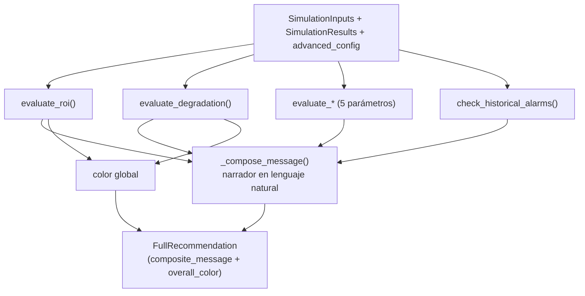

# Motor de Recomendaciones — Especificación

> **Componente core de la herramienta.** Este documento es la referencia
> normativa de cómo se generan las recomendaciones que ve el operador. Define la
> lógica de negocio, los umbrales, la redacción del mensaje y el código fuente
> asociado, de modo que cualquier decisión sea defendible y trazable.
>
> Documentos relacionados:
> - [arbol-decisiones-bess.md](../01-analysis/modulo%201/arbol-decisiones-bess.md) — árbol original de la pizarra de diseño.
> - [matriz-recomendaciones-fuera-de-rango.md](../01-analysis/modulo%201/matriz-recomendaciones-fuera-de-rango.md) — matriz de alarmas de histórico.
> - [modelo-datos.md](modelo-datos.md) — estructuras `FullRecommendation`, `RecommendationResult`, etc.

---

## 1. Objetivo y principios de diseño

El motor traduce los resultados numéricos de una simulación (ROI, VAN, SoH,
RTE, OPEX…) en una **recomendación explicativa** para el operador. Se rige por
tres principios acordados con negocio:

1. **Informar, no desaconsejar.** La herramienta nunca emite un veredicto
   prohibitivo ("no recomendado", cruz roja). Expone las **consecuencias** de
   cada elección para que sea el operador quien decida si las asume. Una BESS
   de baja rentabilidad puede ser perfectamente válida por motivos estratégicos.

2. **Lenguaje natural.** El mensaje final es un texto en prosa con conectores,
   no una concatenación de frases sueltas unidas por `+`. La lógica de
   *diagnóstico* (qué se evalúa) está separada de la *redacción* (cómo se cuenta).

3. **Umbrales configurables.** Todos los cortes de clasificación viven en
   `DEFAULT_ADVANCED_CONFIG` y son editables y persistentes desde la pantalla
   **Configuración del Modelo → Umbrales de Recomendación**. No hay valores
   "mágicos" incrustados en el código.

---

## 2. Arquitectura del módulo

```
src/bess_simulator/recommendations/
├── __init__.py             # generate_full_recommendation() + narrador (_compose_message)
├── decision_tree.py        # evaluate_roi(), evaluate_degradation()  (ejes principales)
├── sub_recommendations.py  # evaluate_* de parámetros (posición margen/límite)
└── alarms.py               # check_historical_alarms() (operación histórica fuera de rango)
```

Punto de entrada único:

```python
generate_full_recommendation(inputs, results, advanced_config) -> FullRecommendation
```

Flujo:



La capa de presentación ([recommendations_panel.py](../../src/bess_simulator/ui/components/recommendations_panel.py))
solo consume dos campos: `composite_message` y `overall_color`. El resto de
campos quedan disponibles para usos futuros (detalle desglosado, export, etc.).

---

## 3. Eje 1 — ROI frente al coste del capital

**Fuente:** `evaluate_roi()` en `decision_tree.py`.

### 3.1 Fundamento de negocio

La tasa de descuento `i` se interpreta como **coste del capital** (a grosso
modo, el "precio del dinero"). La lectura de la rentabilidad **siempre** es
*relativa* a `i`:

- Un `ROI > i` significa que la inversión bate al coste de oportunidad del capital.
- Un `ROI < i` significa que, **en términos puramente financieros**, ese capital
  rendiría más en otra inversión de riesgo equivalente. **Pero esto no descalifica
  la BESS:** puede aportar valor estratégico (cobertura, servicios de red,
  posicionamiento) que justifique asumir una rentabilidad menor.

Por eso el resultado incorpora dos atributos además del mensaje:

| Atributo | Valores | Significado |
|----------|---------|-------------|
| `vs_capital` | `above` / `near` / `below` / `negative` | Posición del ROI respecto a `i` |
| `strategic` | `bool` | `True` cuando el ROI no justifica por sí solo la inversión (ROI ≤ i) y solo compensa por valor estratégico |

### 3.2 Tabla de decisión

Con `i` = tasa de descuento, `high` = `rec_roi_high_threshold`,
`band` = `rec_roi_diversify_band`:

| Condición | label | color | vs_capital | strategic | Lectura |
|-----------|-------|-------|------------|-----------|---------|
| `ROI > i` y `ROI > high` | `rentable` | green | above | — | Rentable, supera el coste del capital con holgura |
| `\|ROI − i\| < band` y `ROI > 0` | `rentable_diversificar` | yellow | near | — | Rentable pero margen ajustado → diversificar beneficios |
| `ROI > i` y `ROI ≤ high` | `moderada` | yellow | above | — | Rentable con retorno moderado, por encima del capital |
| `ROI ≥ i` y `ROI ≤ high` | `moderada` | yellow | near | — | Rentable con retorno moderado, en línea con el capital |
| `0 < ROI < i` | `baja` | blue | below | ✓ | Por debajo del coste del capital → solo si hay valor estratégico |
| `ROI ≤ 0` | `no_rentable` | blue | negative | ✓ | No rentable con estos parámetros → solo estratégico / revisar hipótesis |

> **Nota sobre el orden de evaluación:** la banda de diversificación se comprueba
> **antes** que el tramo "moderada" para que un ROI cercano a `i` se etiquete como
> "diversificar" y no como "moderada", coherente con el árbol original.

> **Cambio respecto a la versión previa:** los dos últimos tramos eran de color
> `red` con mensajes que desaconsejaban ("no recomendado"). Ahora son `blue`
> (informativo/agnóstico) por el principio nº 1.

---

## 4. Eje 2 — Degradación y SoH (cruce ROI × SoH)

**Fuente:** `evaluate_degradation()` en `decision_tree.py`.

Compara la degradación con el umbral `1 − SoHmin`. Si el ciclado previsto lleva
el SoH por debajo del mínimo garantizado, se considera una **consecuencia a
valorar** (no un impedimento).

### 4.1 Año de incumplimiento

Cuando el SoH se compromete, el mensaje informa **a partir de qué año** se cae
por debajo del mínimo garantizado. Para ello `generate_full_recommendation`
pasa la serie `soh_end_by_year` (SoH al cierre de cada año, de
`results.yearly_summary["soh_end"]`) y se localiza el **primer** año con
`SoH < SoHmin` (1-indexado):

```python
for idx, soh in enumerate(soh_end_by_year):
    if soh < soh_min:
        first_breach_year = idx + 1
        break
```

| Condición | color | first_breach_year | Mensaje |
|-----------|-------|-------------------|---------|
| Degradación ≥ `1 − SoHmin`, con año detectado | blue | año N | "…lleva el SoH por debajo del mínimo garantizado **a partir del año N**…" |
| Degradación ≥ `1 − SoHmin`, sin serie anual | blue | None | "…llevará el SoH por debajo del mínimo recomendado al final de la vida útil…" |
| Degradación < `1 − SoHmin` | green | None | "Queda margen de degradación → es posible ciclar algo más para extraer más valor" |

El campo `first_breach_year` queda expuesto en `DegradationResult` para usos
posteriores (resaltar el año en gráficos, etc.).

---

## 5. Eje 3 — Parámetros: posición margen vs. límite

**Fuente:** `sub_recommendations.py` (`evaluate_discount_rate`, `evaluate_opex`,
`evaluate_rte`, `evaluate_lifespan`, `evaluate_retribution_price`).

Estos parámetros **no** son un veredicto "ok/mal". Lo relevante para negocio es
**dónde está el valor dentro de su rango útil**: si ya está en zona óptima o si
queda recorrido de mejora antes de llegar al límite aconsejado. Cada evaluador
devuelve un atributo `position`:

| `position` | Significado |
|------------|-------------|
| `optimal` | En zona óptima, sin margen relevante de mejora (no genera texto) |
| `margin`  | Aceptable, pero queda recorrido de mejora |
| `limit`   | En el límite del rango aconsejado, conviene actuar |

### 5.1 Cortes por parámetro (todos configurables)

| Parámetro | optimal | margin | limit | Claves de config |
|-----------|---------|--------|-------|------------------|
| Tasa de descuento | `< ok` | `ok … warning` | `> warning` | `rec_discount_rate_ok`, `rec_discount_rate_warning` |
| OPEX (€/MW/año) | `< ok` | `ok … warning` | `> warning` | `rec_opex_ok`, `rec_opex_warning` |
| RTE | `≥ ok` | `warning … ok` | `< warning` | `rec_rte_ok`, `rec_rte_warning` |
| Vida útil (años) | `≥ ok` | `warning … ok` | `< warning` | `rec_lifespan_ok`, `rec_lifespan_warning` |
| Precio retribución (€/MWh) | `> ok` | `warning … ok` | `< warning` | `rec_price_ok`, `rec_price_warning` |

> El corte `rec_discount_rate_warning` (= 0.10) **antes estaba incrustado** en
> `evaluate_discount_rate`; ahora es una clave de configuración.

---

## 6. Eje 4 — Alarmas de operación histórica

**Fuente:** `alarms.py` (`check_historical_alarms`, `generate_alarm_message`).

Detecta intervalos del histórico fuera de los rangos aconsejados. Actualmente
implementado para **RTE**; el diseño contempla extenderlo a C-Rate, DoD, SoC y
Temperatura (ver [matriz-recomendaciones-fuera-de-rango.md](../01-analysis/modulo%201/matriz-recomendaciones-fuera-de-rango.md)).
La frase resultante se añade al cierre del mensaje compuesto.

---

## 7. Redacción del mensaje compuesto (narrador)

**Fuente:** `_compose_message()` en `__init__.py`.

El narrador ensambla un párrafo coherente con un **orden de relevancia** fijo y
conectores de lenguaje natural, en lugar de concatenar mensajes con `+`:

1. **Veredicto de rentabilidad** (eje 1), con su lectura frente al coste del
   capital y, si procede, la dimensión estratégica. Es el titular.
2. **Consecuencia sobre la salud de la batería** (eje 2). Conector
   *"Como contrapartida, …"* si el SoH se compromete; *"Por el lado técnico, …"*
   si queda margen.
3. **Posición de los parámetros** (eje 3), en dos frases separadas:
   - *"Conviene revisar con detalle X, Y…, ya en el límite del rango aconsejado"* (position `limit`).
   - *"Aún queda margen de mejora en X, Y…"* (position `margin`).
   Los parámetros se citan con un término natural (mapa `_SUB_TOPICS`), no con
   su clave técnica.
4. **Observación operativa** (eje 4), al cierre.

Utilidades de redacción: `_ensure_period` (garantiza punto final),
`_upper_first` / `_lower_first` (capitalización al unir con conectores) y
`_join_es` (enumeración natural: *"a, b y c"*).

### 7.1 Ejemplo real (parámetros por defecto)

> *"La inversión BESS es rentable, aunque su margen sobre el coste del capital es
> ajustado, por lo que conviene diversificar las fuentes de beneficio. Como
> contrapartida, el ritmo de ciclado previsto lleva el SoH por debajo del mínimo
> garantizado a partir del año 8, una consecuencia a valorar frente a la
> rentabilidad obtenida. Aún queda margen de mejora en el coste de mantenimiento
> (OPEX) y el rendimiento de ciclo (RTE)."*

---

## 8. Color global de la tarjeta

**Fuente:** `generate_full_recommendation` + `_STATUS_MAP` en `recommendations_panel.py`.

El color se resuelve a partir de `roi_result.color` y `degradation_result.color`
con esta prioridad semántica:

| overall_color | Prioridad | icono | etiqueta | Significado |
|---------------|-----------|-------|----------|-------------|
| `blue` | 1ª | `i` | "A valorar por el operador" | Hay una consecuencia/compromiso a valorar (ROI < coste capital o SoH al límite). Informativo, **nunca** "no recomendado". |
| `yellow` | 2ª | `!` | "Rentable con aspectos a vigilar" | Rentable pero con aspectos a vigilar |
| `green` | 3ª | `✓` | "Rentable y seguro" | Rentable y sin alertas relevantes |

> **Diseño visual:** tarjeta blanca con texto oscuro y una barra/círculo de
> acento del color del estado. Se eliminó el antiguo fondo rosa pastel (`#f8d7da`)
> y la cruz roja para alinear con el principio de "informar, no desaconsejar".

---

## 9. Configuración de umbrales

Todos los cortes son claves de `DEFAULT_ADVANCED_CONFIG`
([app_config.py](../../src/bess_simulator/storage/app_config.py)), persistidas en
BD (`save_config`/`load_config`) y editables en **Configuración del Modelo →
Umbrales de Recomendación** ([settings.py](../../src/bess_simulator/ui/views/settings.py)),
con botón de restaurar valores por defecto.

| Clave | Defecto | Uso |
|-------|---------|-----|
| `rec_roi_high_threshold` | 0.08 | Frontera de rentabilidad holgada (ROI) |
| `rec_roi_diversify_band` | 0.02 | Banda alrededor de `i` para "diversificar" |
| `rec_discount_rate_ok` | 0.08 | Tasa de descuento en zona óptima |
| `rec_discount_rate_warning` | 0.10 | Tasa de descuento en el límite |
| `rec_opex_ok` | 10 000 | OPEX óptimo (€/MW/año) |
| `rec_opex_warning` | 15 000 | OPEX en el límite |
| `rec_rte_ok` | 0.86 | RTE óptimo |
| `rec_rte_warning` | 0.80 | RTE en el límite |
| `rec_lifespan_ok` | 15 | Vida útil óptima (años) |
| `rec_lifespan_warning` | 10 | Vida útil en el límite |
| `rec_price_ok` | 45.0 | Precio óptimo (€/MWh) |
| `rec_price_warning` | 30.0 | Precio en el límite |

---

## 10. Trazabilidad de cambios (frente a la versión inicial)

| Cambio | Antes | Ahora | Motivo |
|--------|-------|-------|--------|
| Tono del tramo no rentable | `red`, "No recomendado", cruz ✕ | `blue`, "A valorar por el operador", icono `i` | Informar, no desaconsejar |
| Mensaje compuesto | `" + ".join(parts)` | Prosa con conectores (`_compose_message`) | Lenguaje natural |
| ROI vs capital | Mensaje plano | Atributos `vs_capital` + `strategic` y lectura explícita | Reflejar coste del capital y valor estratégico |
| Parámetros | "ok/warning/alert" | Posición `optimal/margin/limit` ("hay margen" vs "al límite") | Lectura de margen de mejora |
| Año de incumplimiento SoH | No se indicaba | "a partir del año N" | Petición de negocio |
| Umbral 0.10 discount rate | Incrustado en código | Clave `rec_discount_rate_warning` | Umbrales 100% configurables |
| UI de umbrales | Faltaban 3 claves | Todas expuestas y agrupadas por parámetro | Configuración completa |

Todos los cambios son **reversibles** (solo afectan a `recommendations/`,
`settings.py`, `app_config.py` y `recommendations_panel.py`) y la suite de
pruebas (91 tests) sigue en verde.
